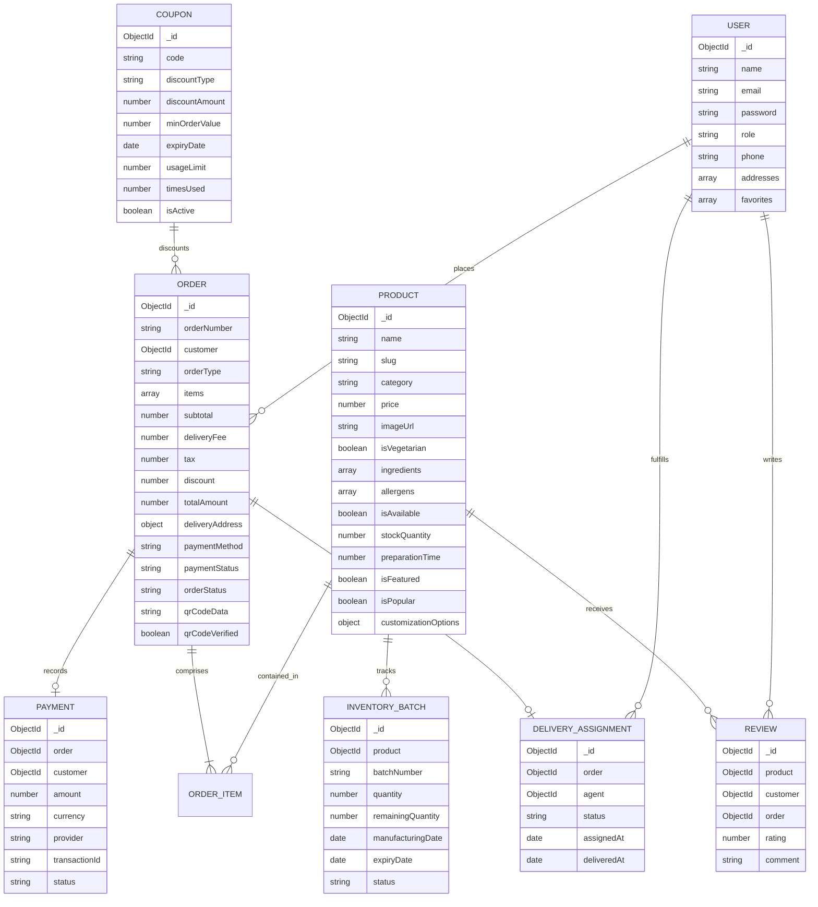

# Smart Bakery & Café — System Architecture & Design Specification

## 1. High-Level System Overview

Smart Bakery & Café is a modern, high-performance, full-stack e-commerce and order management application built for artisanal bakeries and contemporary cafés. It provides an end-to-end digital lifecycle: from customer discovery, live product customization (bespoke cake design and beverage add-ons), geo-fenced 5 km delivery validation, and coupon-driven checkout to real-time kitchen orchestration, delivery agent task management, and QR-based pickup verification.

```mermaid
graph TD
    Client["Client Browser (React 18 + Vite SPA)"]
    Admin["Admin / Kitchen / Delivery Agent Portal"]
    API["Express.js REST API + Middleware"]
    SocketServer["Socket.IO Real-Time Gateway"]
    DB[(MongoDB Atlas / Local Mongoose)]
    GeoEngine["Haversine 5km Geo-Validation Engine"]
    PaymentGateway["Payment Processor (COD / Razorpay Test)"]

    Client -->|HTTP / JSON + JWT Cookies| API
    Client <-->|WebSockets (Order Status Rooms)| SocketServer
    Admin -->|HTTP / JSON + RBAC Auth| API
    Admin <-->|WebSockets (Live Order Dispatch)| SocketServer
    API --> GeoEngine
    API --> DB
    API --> PaymentGateway
    SocketServer --> API
```

---

## 2. Layered Architecture Principles

The application strictly separates concerns across independent layers to guarantee maintainability, high testability, and enterprise-grade security:

### A. Client-Side Architecture (React + Vite)
- **Component-Driven UI**: Modular atomic components (buttons, input fields, modal dialogs, status badges, product cards, toast notifications).
- **Centralized Context Providers**:
  - `AuthContext`: Manages authenticated user state, roles (`customer`, `admin`, `delivery_agent`), login/registration flows, and profile updates.
  - `CartContext`: Local-storage backed shopping cart with live subtotal, GST/tax calculation, dynamic cake/beverage customization options, and coupon discount calculations.
  - `LocationContext`: Manages browser Geolocation coordinates, manual address input, and real-time Haversine distance queries against the store coordinate.
  - `SocketContext`: Connects to the backend Socket.IO instance and manages room subscriptions for live order tracking (`order_{id}`, `kitchen_channel`, `delivery_channel`).
- **Service Abstraction**: Dedicated API modules (`apiClient.js`, `authService.js`, `productService.js`, `orderService.js`, `adminService.js`) using Axios with `withCredentials: true` for automatic HTTP-only cookie forwarding.

### B. Server-Side Architecture (Node.js + Express)
- **Controller-Service-Repository Pattern**:
  - **Routes (`/routes`)**: Define HTTP verbs, endpoint paths, and chain validation/auth middleware.
  - **Controllers (`/controllers`)**: Parse incoming requests, coordinate business logic, and formulate standard JSON envelopes.
  - **Services (`/services`)**: Reusable business logic (e.g., `distanceService.js`, `inventoryService.js`, `qrService.js`, `paymentService.js`).
  - **Models (`/models`)**: Strongly-typed Mongoose schemas with pre-save hooks, validation rules, virtuals, and compound indexes.
  - **Middleware (`/middleware`)**: Authentication guards (`protect`), Role-based access control (`authorize`), rate-limiting, error handling, and request logging.
  - **Validators (`/validators`)**: Express-validator schemas that sanitize and enforce strict types before reaching business controllers.

---

## 3. Mandatory 5 KM Delivery Radius Engine

Delivery eligibility is determined through the spherical Haversine formula implemented on the server:

$$d = 2 \cdot R \cdot \arcsin\left(\sqrt{\sin^2\left(\frac{\Delta\phi}{2}\right) + \cos(\phi_1)\cos(\phi_2)\sin^2\left(\frac{\Delta\lambda}{2}\right)}\right)$$

Where:
- $R = 6371\text{ km}$ (mean radius of Earth).
- $\phi_1, \lambda_1$ are the bakery's latitude and longitude (configured via `BAKERY_LAT`, `BAKERY_LNG`).
- $\phi_2, \lambda_2$ are the customer's coordinates provided via Geolocation or manual pin placement.

### Security Guarantee:
1. The frontend queries `/api/delivery/check?lat={lat}&lng={lng}` for instant UI eligibility feedback.
2. **Crucially, the checkout endpoint (`POST /api/orders`) re-calculates and re-validates the coordinates on the backend.** Any attempt to tamper with client payload will result in HTTP `400 Bad Request: Delivery location exceeds permitted 5.0 km boundary`.

---

## 4. Entity-Relationship (ER) Data Model



---

## 5. Security Architecture

1. **Authentication**:
   - Passwords hashed using `bcryptjs` with 10 salt rounds.
   - JWT tokens signed using `HS256` with strong secret.
   - Tokens transmitted via `Set-Cookie` with `httpOnly: true`, `secure: process.env.NODE_ENV === 'production'`, `sameSite: 'strict'`, preventing XSS token theft.
   - Fallback `Authorization: Bearer <token>` supported for automated API testing.
2. **Authorization & RBAC**:
   - `protect`: Verifies JWT validity, extracts customer ID, checks if user still exists in DB.
   - `authorize(...roles)`: Restricts routes to specific roles (`admin`, `delivery_agent`).
3. **Data Protection**:
   - Centralized error handler masks internal stack traces in production.
   - Rate limiting on `/api/auth/*` prevents brute-force credential stuffing.
   - Express helmet sets security HTTP headers (CSP, HSTS, X-Frame-Options).
   - MongoDB injection prevention via Mongoose schema type sanitization.

---

## 6. Real-Time Order Lifecycle Workflow

```
[Customer Checkout] 
       │
       ▼
(Pending) ──[Admin/Kitchen Accept]──► (Confirmed)
                                            │
                                            ▼
                                       (Preparing)
                                            │
                                            ▼
                                  (Ready for Dispatch)
                                     /             \
                  [If Delivery]    /                 \   [If Pickup]
                                 ▼                     ▼
                       (Out for Delivery)       (QR Code Scan Verified)
                                 │                     │
                                 ▼                     ▼
                            (Delivered)           (Delivered)
```

1. **Pending**: Order registered; stock reserved; payment initiated/pending.
2. **Confirmed**: Kitchen accepts order; preparation timer starts.
3. **Preparing**: Chef/Baker actively assembling cake or cooking meal.
4. **Ready for Dispatch**: Order packaged; ready for courier assignment or customer counter pickup.
5. **Out for Delivery**: Delivery agent picks up parcel and begins transit.
6. **Delivered**: Delivery confirmed via agent app or customer QR code scan at counter.
