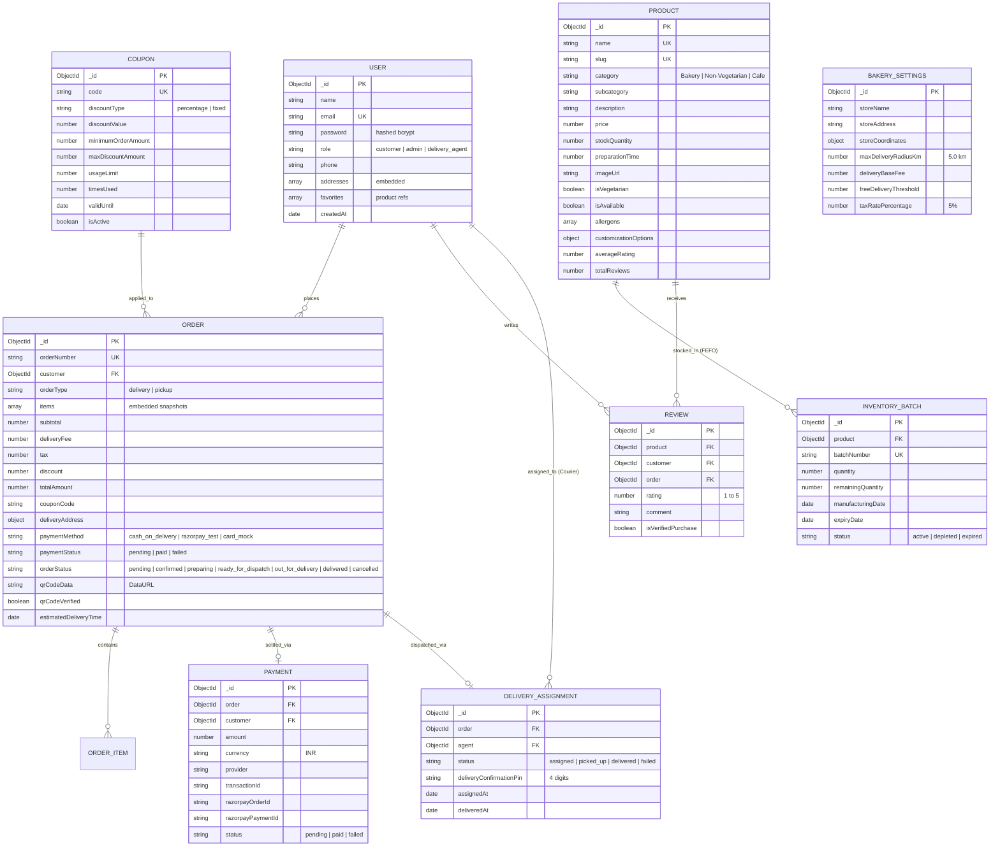

# Smart Bakery & Café — Database Design & Schema Specification

This document details the MongoDB data architecture for **Smart Bakery & Café**, engineered with **Mongoose ODM**. It documents all collections, relationship cardinalities, compound indexes, constraint checks, and the First-Expired-First-Out (FEFO) inventory allocation strategy.

---

## 1. Entity-Relationship Diagram (ERD)

---

## 2. Collection Schemas & Detailed Field Specifications

### 2.1 Users Collection (`users`)

Stores customer credentials, administrative staff accounts, courier agents, and embedded delivery addresses with GPS coordinates.

| Field | Type | Required | Constraints / Defaults | Description |
|---|---|---|---|---|
| `_id` | ObjectId | Yes | Auto-generated PK | Unique user identifier |
| `name` | String | Yes | Trimmed, 2-100 chars | Full name of the user |
| `email` | String | Yes | Unique, Lowercase, Regex | Email address used for authentication |
| `password` | String | Yes | Min 8 chars, hashed | Bcrypt hashed password (10 salt rounds) |
| `role` | String | Yes | Enum: `customer`, `admin`, `delivery_agent` | Role-based access control tier |
| `phone` | String | No | Regex: 10-14 digits | Contact number for delivery calls |
| `addresses` | Array | No | Sub-documents array | Saved customer addresses with GPS coordinates |
| `addresses.street` | String | Yes | Trimmed | Street address, flat or apartment number |
| `addresses.city` | String | Yes | Default: `New Delhi` | City name |
| `addresses.pincode`| String | Yes | 6-digit postal code | Postal PIN code |
| `addresses.coordinates.lat` | Number | Yes | -90 to 90 | Latitude coordinate for geo-radius check |
| `addresses.coordinates.lng` | Number | Yes | -180 to 180 | Longitude coordinate for geo-radius check |
| `favorites` | Array | No | Refs to `Product` | Wishlisted confections and café brews |
| `createdAt` | Date | Yes | Default: `Date.now` | Registration timestamp |

**Indexes:**
- `{ email: 1 }` (Unique)
- `{ role: 1 }` (Fast role lookups)

---

### 2.2 Products Collection (`products`)

Contains the 30 seeded confections, savories, and café brews, alongside preparation times and customization rules.

| Field | Type | Required | Constraints / Defaults | Description |
|---|---|---|---|---|
| `_id` | ObjectId | Yes | Auto-generated PK | Unique product identifier |
| `name` | String | Yes | Unique, Trimmed | Display title (e.g. `Belgian Chocolate Truffle Cake`) |
| `slug` | String | Yes | Unique, Auto-generated | URL-friendly slug (e.g. `belgian-chocolate-truffle-cake`) |
| `category` | String | Yes | Enum: `Bakery`, `Non-Vegetarian`, `Cafe` | Department classification |
| `subcategory` | String | Yes | e.g. `Cakes`, `Pastries`, `Brews` | Secondary navigational grouping |
| `description` | String | Yes | Max 1000 chars | Flavor profile, texture, and baking notes |
| `price` | Number | Yes | Min: 0 | Base price in Indian Rupees (₹) |
| `stockQuantity` | Number | Yes | Min: 0, Default: 50 | Total available units across batches |
| `preparationTime` | Number | Yes | Default: 20 | Kitchen baking/brewing target in minutes |
| `imageUrl` | String | Yes | Path or URL | High-definition product thumbnail |
| `isVegetarian` | Boolean | Yes | Default: `true` | Green veg indicator vs red non-veg symbol |
| `isAvailable` | Boolean | Yes | Default: `true` | Toggle visibility on active customer menu |
| `allergens` | [String] | No | Set of allergen tags | e.g. `['Gluten', 'Dairy', 'Eggs', 'Nuts']` |
| `customizationOptions` | Object | No | Embedded schemas | Config for Cake builder and Beverage builder |
| `averageRating` | Number | Yes | Default: 4.8, 1-5 | Cached aggregated review rating |
| `totalReviews` | Number | Yes | Default: 0 | Cached count of verified buyer reviews |

**Indexes:**
- `{ slug: 1 }` (Unique)
- `{ category: 1, isAvailable: 1 }` (Catalogue query acceleration)
- `{ price: 1 }` (Price sorting)

---

### 2.3 Inventory Batches Collection (`inventorybatches`)

Drives the **First-Expired-First-Out (FEFO)** stock allocation strategy.

| Field | Type | Required | Constraints / Defaults | Description |
|---|---|---|---|---|
| `_id` | ObjectId | Yes | Auto-generated PK | Unique lot identifier |
| `product` | ObjectId | Yes | Ref: `Product` | Product associated with this batch |
| `batchNumber` | String | Yes | Unique, Format: `BATCH-YYYYMMDD-XXX` | Official manufacturing batch lot code |
| `quantity` | Number | Yes | Min: 1 | Initial units baked / manufactured |
| `remainingQuantity` | Number | Yes | Min: 0 | Unallocated units remaining in this lot |
| `manufacturingDate` | Date | Yes | Default: `Date.now` | Oven removal / baking timestamp |
| `expiryDate` | Date | Yes | Indexed | Freshness threshold date |
| `status` | String | Yes | Enum: `active`, `depleted`, `expired` | Current availability state |

**Indexes:**
- `{ product: 1, expiryDate: 1 }` (Core FEFO compound index: orders deduct from earliest expiry first)
- `{ status: 1 }`

---

### 2.4 Orders Collection (`orders`)

Stores completed checkout orders, snapshot line-items, and delivery GPS distance metadata.

| Field | Type | Required | Constraints / Defaults | Description |
|---|---|---|---|---|
| `_id` | ObjectId | Yes | Auto-generated PK | Unique order identifier |
| `orderNumber` | String | Yes | Unique, Format: `SBK-YYYYMMDD-XXXX` | Human-readable tracking number |
| `customer` | ObjectId | Yes | Ref: `User` | User who placed the order |
| `orderType` | String | Yes | Enum: `delivery`, `pickup` | Fulfillment mode |
| `items` | Array | Yes | Embedded snapshot array | Immutable line items at time of purchase |
| `items.product` | ObjectId | Yes | Ref: `Product` | Product reference |
| `items.name` | String | Yes | Snapshot name | Preserves historical title |
| `items.unitPrice` | Number | Yes | Snapshot price + deltas | Final unit cost including add-ons |
| `items.quantity` | Number | Yes | Min: 1 | Units ordered |
| `items.subtotal` | Number | Yes | `unitPrice * quantity` | Line-item total |
| `items.customizations`| Object | No | Piped text, milk, eggless | Chosen customizer configurations |
| `subtotal` | Number | Yes | Min: 0 | Gross items cost before discounts |
| `deliveryFee` | Number | Yes | ₹0 (Pickup or >= ₹500), else ₹40 | Delivery charge |
| `tax` | Number | Yes | 5% GST (CGST + SGST) | Goods & Services Tax |
| `discount` | Number | Yes | Default: 0 | Deduction from applied promo code |
| `totalAmount` | Number | Yes | Min: 0 | Net payable amount |
| `couponCode` | String | No | Uppercase string | Code used during checkout |
| `deliveryAddress` | Object | Conditional | Required if `delivery` | Destination address with straight-line distance |
| `deliveryAddress.distanceKm` | Number | No | Round to 2 decimals | Calculated Haversine distance (< 5.0 km) |
| `paymentMethod` | String | Yes | Enum: `cash_on_delivery`, `razorpay_test` | Payment option selected |
| `paymentStatus` | String | Yes | Enum: `pending`, `paid`, `failed` | Payment settlement status |
| `orderStatus` | String | Yes | Enum: `pending`, `confirmed`, `preparing`, `ready_for_dispatch`, `out_for_delivery`, `delivered`, `cancelled` | State machine workflow status |
| `qrCodeData` | String | Conditional | Base64 DataURL | HMAC signed QR pass for store pickup |
| `qrCodeVerified` | Boolean | Yes | Default: `false` | True when cashier scans pass |
| `deliveryAssignment` | ObjectId | No | Ref: `DeliveryAssignment` | Assigned courier task |

**Indexes:**
- `{ orderNumber: 1 }` (Unique)
- `{ customer: 1, createdAt: -1 }` (User order history sorting)
- `{ orderStatus: 1, createdAt: -1 }` (Kitchen KDS query acceleration)

---

### 2.5 Coupons Collection (`coupons`)

| Field | Type | Required | Constraints / Defaults | Description |
|---|---|---|---|---|
| `_id` | ObjectId | Yes | Auto-generated PK | Unique coupon ID |
| `code` | String | Yes | Unique, Uppercase | Promo code entered at checkout |
| `discountType` | String | Yes | Enum: `percentage`, `fixed` | Computation method |
| `discountValue` | Number | Yes | Min: 1 | Percentage off or flat INR amount |
| `minimumOrderAmount`| Number | Yes | Default: 0 | Minimum cart subtotal required |
| `maxDiscountAmount` | Number | No | Optional cap | Maximum deduction ceiling |
| `usageLimit` | Number | No | Optional limit | Maximum redemptions permitted |
| `timesUsed` | Number | Yes | Default: 0 | Running tally of redemptions |
| `validUntil` | Date | Yes | Timestamp | Expiration deadline |
| `isActive` | Boolean | Yes | Default: `true` | Administrative activation toggle |

---

### 2.6 Payments Collection (`payments`)

Audit trail recording payment gateway transactions, simulated sandboxes, and verification signatures.

| Field | Type | Required | Constraints / Defaults | Description |
|---|---|---|---|---|
| `_id` | ObjectId | Yes | Auto-generated PK | Unique payment transaction ID |
| `order` | ObjectId | Yes | Ref: `Order` | Associated order |
| `customer` | ObjectId | Yes | Ref: `User` | User who paid |
| `amount` | Number | Yes | In INR | Amount transacted |
| `currency` | String | Yes | Default: `INR` | Currency code |
| `provider` | String | Yes | `razorpay_test`, `cash_on_delivery` | Payment rail |
| `transactionId` | String | Yes | Unique | Gateway or mock transaction ID |
| `razorpayOrderId` | String | No | Gateway order reference | Razorpay order ID |
| `razorpayPaymentId`| String | No | Gateway payment reference | Razorpay payment ID |
| `razorpaySignature`| String | No | Hex string | Cryptographic verification signature |
| `status` | String | Yes | Enum: `pending`, `paid`, `failed` | Final payment state |

---

### 2.7 Reviews Collection (`reviews`)

Enforces verified customer reviews with rating updates.

| Field | Type | Required | Constraints / Defaults | Description |
|---|---|---|---|---|
| `_id` | ObjectId | Yes | Auto-generated PK | Unique review ID |
| `product` | ObjectId | Yes | Ref: `Product` | Reviewed item |
| `customer` | ObjectId | Yes | Ref: `User` | Reviewer |
| `order` | ObjectId | Yes | Ref: `Order` | Delivered order proof |
| `rating` | Number | Yes | 1 to 5 (integer) | Star rating |
| `comment` | String | No | Max 500 chars | Customer feedback |
| `isVerifiedPurchase`| Boolean | Yes | Default: `true` | Confirms order delivery |

**Constraint:**
- `{ product: 1, customer: 1, order: 1 }` (Unique compound index: prevents duplicate reviews per order)

---

### 2.8 Delivery Assignments Collection (`deliveryassignments`)

Manages courier assignments, customer handshake PIN verification, and transit timestamps.

| Field | Type | Required | Constraints / Defaults | Description |
|---|---|---|---|---|
| `_id` | ObjectId | Yes | Auto-generated PK | Unique assignment ID |
| `order` | ObjectId | Yes | Ref: `Order`, Unique | One-to-one order assignment |
| `agent` | ObjectId | Yes | Ref: `User` (role: delivery_agent) | Assigned courier |
| `status` | String | Yes | Enum: `assigned`, `picked_up`, `delivered`, `failed` | Courier progress |
| `deliveryConfirmationPin` | String | Yes | 4 digits | Handshake OTP required from customer |
| `deliveryNotes` | String | No | e.g. "Fragile cake" | Dispatch instructions |
| `assignedAt` | Date | Yes | Default: `Date.now` | Assignment timestamp |
| `pickedUpAt` | Date | No | Timestamp | Oven collection time |
| `deliveredAt` | Date | No | Timestamp | Completion time |

---

### 2.9 Bakery Settings Collection (`bakerysettings`)

Singleton collection holding store-wide delivery coordinates, radius rules, and base fees.

| Field | Type | Required | Constraints / Defaults | Description |
|---|---|---|---|---|
| `_id` | ObjectId | Yes | Auto-generated PK | Singleton setting document |
| `storeName` | String | Yes | Default: `Smart Bakery & Café` | Store branding |
| `storeAddress` | String | Yes | Connaught Place, New Delhi | Physical bakery address |
| `storeCoordinates.lat` | Number | Yes | Default: `28.6315` | Central kitchen latitude |
| `storeCoordinates.lng` | Number | Yes | Default: `77.2167` | Central kitchen longitude |
| `maxDeliveryRadiusKm` | Number | Yes | Default: `5.0` | Maximum delivery distance |
| `deliveryBaseFee` | Number | Yes | Default: `40` | Base delivery fee in INR |
| `freeDeliveryThreshold`| Number | Yes | Default: `500` | Free delivery cart threshold |
| `taxRatePercentage` | Number | Yes | Default: `5` | Applicable GST percentage |

---

## 3. Data Integrity & Consistency Rules

1. **FEFO Stock Allocation Engine**:
   - Stock is allocated using `expiryDate: 1`.
   - Decrement queries use atomic `$inc` operators with `$gte: quantity` conditions to avoid race conditions.
2. **Order State Machine Transitions**:
   - Status changes are validated against `VALID_TRANSITIONS`.
   - Transitions directly from `pending` to `delivered` are rejected.
3. **Geo-Fencing Enforcement**:
   - `POST /api/orders` checks distance via `calculateHaversineDistance`.
   - Orders with straight-line distance $> 5.0\text{ km}$ are blocked at the controller level.
4. **Verified Reviews**:
   - `POST /api/reviews` checks that the order exists, belongs to the logged-in customer, and has `orderStatus: 'delivered'`.
   - After creation, the product's `averageRating` is recomputed and cached automatically.
